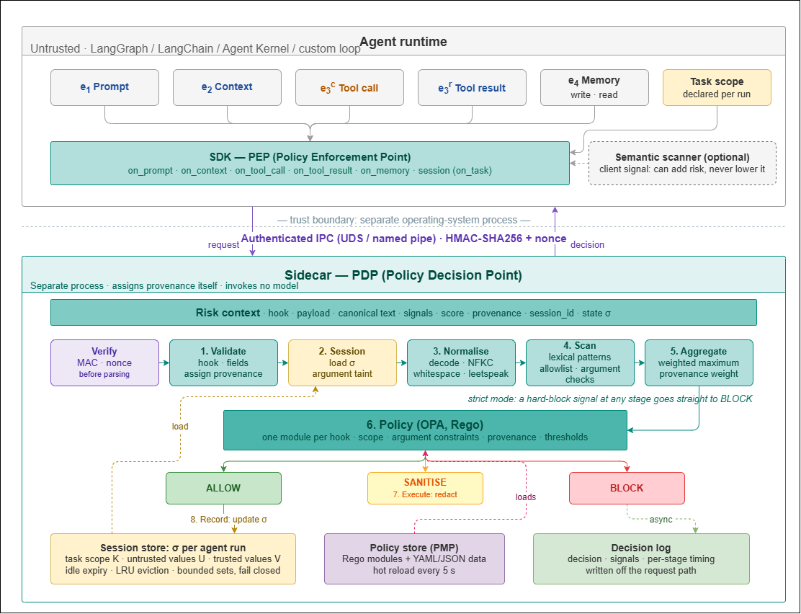

# ACF examples

Runnable scripts that drive the real sidecar through the Python SDK. Each one
prints every decision next to the one it expects and ends with `PASS` or `FAIL`.

| Folder | What it shows | Sidecar policy |
|---|---|---|
| [`basics/`](basics/) | One hook at a time, without sessions: prompts, retrieved documents, tool calls, memory, and request validation | the shipped `policies/v1` |
| [`banking/`](banking/) | A small banking agent: its own application policy, task scope, tool-result screening, the provenance rule, user confirmation, and a full agent loop | `policies/v1` rules + `banking/policy.yaml` |
| [`adapters/`](adapters/) | ACF as a node in a LangGraph graph | the shipped `policies/v1` |

Start with `basics/` to see what each hook does, then `banking/`, which is where
the security comes from: policies that decide what an agent may do with what it
read, whether or not an attack was recognised.

---

## Setup

### 1. Make a key

The SDK signs every request with an HMAC key and the sidecar verifies it, so
both need the same one:

```bash
python3 -c "import secrets; print(secrets.token_hex(32))"
```

### 2. Start the sidecar (terminal 1)

```bash
export ACF_HMAC_KEY="<the key>"           # PowerShell: $env:ACF_HMAC_KEY = "<the key>"
cd sidecar && go run ./cmd/sidecar        # listens on /tmp/acf.sock, or \\.\pipe\acf on Windows
```

For `banking/`, start it with the banking policy instead (from the repository root):

```bash
python examples/banking/run_sidecar.py
```

### 3. Run the examples (terminal 2)

```bash
export ACF_HMAC_KEY="<the same key>"
pip install -e sdk/python
python examples/basics/01_prompt.py
python examples/banking/03_provenance.py
```

---

## basics/

Sessionless calls against the shipped policy.

| Script | Hook | Shows |
|---|---|---|
| `01_prompt.py` | `on_prompt` | A known jailbreak phrase is blocked, also in Base64, with zero-width characters, or in leetspeak; a paraphrase is not detected |
| `02_context.py` | `on_context` | A retrieved chunk carrying an instruction is sanitised; a clean one passes |
| `03_tool_call.py` | `on_tool_call` | The fail-closed tool policy: allowlist, shell commands, path traversal |
| `04_memory.py` | `on_memory` | Writes are scanned; reads without an integrity proof are blocked |
| `05_validate.py` | — | Malformed requests are blocked before any policy runs |

## banking/

A banking assistant that can read files and send money. Its tools are in
[`bank.py`](banking/bank.py), and its bill file hides an attacker's instruction
in a polite note signed by the user, with no phrase a scanner would recognise.

**The application policy** is [`policy.yaml`](banking/policy.yaml), the part of
ACF a developer writes:

```yaml
tool_allowlist:      [read_file, get_balance, ..., send_money, update_password]
consequential_tools: [send_money, update_scheduled_transaction, update_password]
sensitive_params:    {send_money: [recipient], update_scheduled_transaction: [recipient]}
trusted_tools:       [get_scheduled_transactions]
```

The Rego rules stay as shipped. `run_sidecar.py` copies `policies/v1`, merges
these keys over its `data/policy_config.yaml`, and starts the sidecar with the
result.

| Script | Shows |
|---|---|
| `01_task_scope.py` | A session declares the task's tools and argument bounds; anything else is blocked, and a scope can only narrow the allowlist |
| `02_screen_tool_results.py` | `on_tool_result` sanitises a known attack phrase, but the signed note passes: detection alone is not enough |
| `03_provenance.py` | Paying an account read from the bill is blocked, the attacker's and the real payee's alike; after the user confirms the payee (`trusted_values`), only that payment goes through. An account the user typed is trusted from the start |
| `04_agent_loop.py` | Where each hook sits in an agent loop, with a scripted model that obeys any instruction it reads: without ACF the attacker is paid, with ACF nothing leaves the bank |

What a developer writes, in one place:

```python
with fw.session(
    allowed_tools=["read_file", "send_money"],                  # task scope
    tool_constraints={"send_money": {"amount": {"max": 500}}},   # argument bounds
    trusted_values=[confirmed_payee],                            # values the user vouched for
) as s:
    s.on_prompt(request)                      # values in the request are trusted
    verdict = s.on_tool_call(tool, args)      # before the tool runs
    screened = s.on_tool_result(tool, output) # before the model reads the result
```

## adapters/

| Script | Shows |
|---|---|
| `langgraph_prompt_guard.py` | A `FirewallNode` in front of the model node stops a jailbreak before the model runs |
| `langgraph_context_filter.py` | A `FirewallNode` sanitises retrieved documents in graph state |
| `langchain_guarded_tools.py` | `guard_tools` wraps LangChain tools so every call and result passes through a session |

These need the framework installed (`pip install langgraph`, `pip install langchain-core`).

---

## How a request is decided



The SDK signs each request and sends it to the sidecar, a separate process. The
sidecar validates it, loads the session state, normalises and scans the text,
scores the signals, and evaluates the Rego policy for that hook. Only the
policy decides. Its decision comes back as `ALLOW`, `SANITISE` (with the
cleaned text), or `BLOCK`. Details: [`docs/pipeline.md`](../docs/pipeline.md)
and [`docs/application-policy-layer.md`](../docs/application-policy-layer.md).
